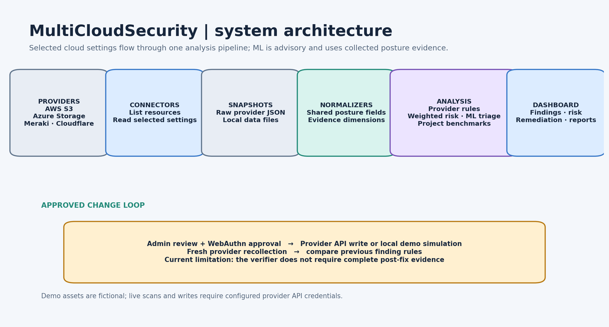
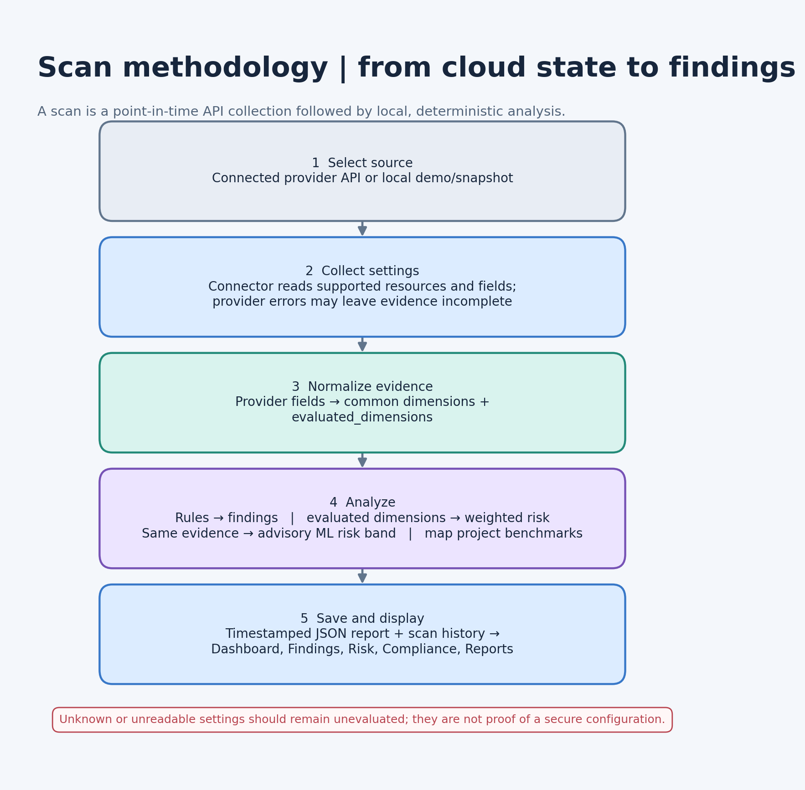
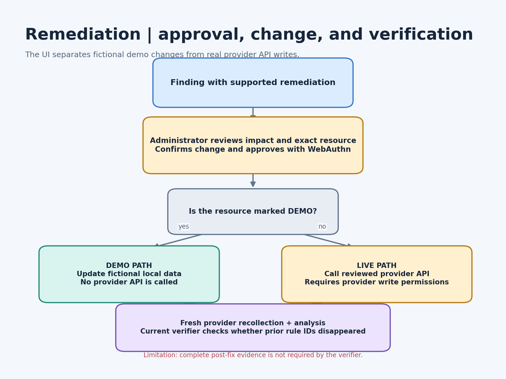
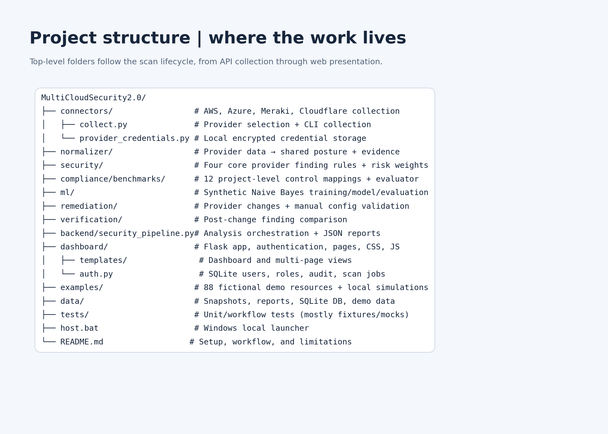

# MultiCloudSecurity: End-to-End Project Walkthrough

This guide explains the project as it is implemented in this repository. It is written for a project presentation or evaluator walkthrough. The system is a prototype with real provider integrations for selected configuration types; it is not a full cloud posture platform.

## 1. What the project does

MultiCloudSecurity collects selected cloud configuration, converts it into a common representation, checks it with deterministic rules, estimates risk, maps evidence to project benchmarks, and presents the results in a local web dashboard. An administrator can review supported changes and, for live resources, the application can call provider APIs to apply a limited fix and collect the configuration again.

The four supported services are AWS S3, Azure Storage, Cisco Meraki networks, and Cloudflare zones/accounts. Coverage is intentionally narrow: there is currently one core finding rule for each provider. Do not describe it as a comprehensive scanner.



## 2. End-to-end scan methodology

### Step 1: Choose the data source

The project can analyze local JSON snapshots, fictional evaluator-demo resources, or configurations collected from a connected provider API. Demo resources are fictional and use local simulation; they do not contact cloud services. Live collection needs appropriately scoped provider credentials and API permissions.

### Step 2: Collect provider configuration

`connectors/collect.py` chooses a provider connector. The connectors collect selected settings:

- **AWS:** list S3 buckets, then read each bucket's public-access-block and encryption configuration.
- **Azure:** list Storage accounts and read selected network, blob-public-access, HTTPS, TLS, and encryption fields.
- **Cisco Meraki:** enumerate organizations and networks, then read Layer 3 firewall rules.
- **Cloudflare:** enumerate accounts and zones, then inspect managed WAF phase rules and ruleset metadata.

The collector writes snapshots under `data/`. This is a snapshot scanner; the optional browser refresh is polling, not event-driven detection. The AWS per-bucket configuration reads currently run sequentially.

### Step 3: Normalize and retain evidence coverage

`normalizer/` maps each provider's different fields into seven shared dimensions: exposure, privilege, encryption, logging, network security, identity security, and configuration security. Each normalized resource also contains `evaluated_dimensions`, which indicate which dimensions the connector actually observed.

This evidence list matters: a missing value should not automatically be interpreted as secure. The risk calculation and benchmark engine use evaluation coverage to avoid treating every default zero as proof of safety. Some provider fields are still not collected or not marked as fully evaluated.

### Step 4: Run the analysis pipeline

`backend/security_pipeline.py` processes each resource in this order:

1. Run the provider's deterministic security rule function.
2. Calculate weighted risk using only evaluated dimensions.
3. Add the advisory ML risk band.
4. Build remediation recommendations for known finding IDs.
5. Evaluate the project-defined benchmark mappings.
6. Save a timestamped JSON report and scan history.

The rule checks are the primary detectors. Benchmarks organize collected evidence; their CIS/NIST references are project mappings, not official provider-specific certifications.

The current ML model is Gaussian Naive Bayes trained on generated synthetic scenarios. It scores the same normalized evidence as the rules; it is not a separate sensor. The recorded 91.85% score is agreement with a synthetic holdout, not accuracy on real cloud resources. ML does not approve or execute changes.



### Step 5: View the report

The Flask dashboard presents the report across Dashboard, Cloud Resources, Findings, Risk Analysis, Remediation, Compliance, Machine Learning, Reports, Connections, and Settings pages. Scan jobs run in a background thread; the current app allows one scan at a time. Reports and audit events are stored locally.

## 3. Remediation workflow and safety boundaries

For a supported finding, an administrator reviews the proposed change and impact, explicitly confirms it, and approves using an enrolled WebAuthn credential such as Windows Hello. The application then takes one of two paths:

- **Demo resource:** update the fictional local demo record and recompute its findings. No provider API is called.
- **Live resource:** call the specific provider API, recollect provider configuration, run analysis again, and compare the old finding with the new result.

The intended principle is closed-loop remediation: propose, approve, change, recollect, and verify. Current verification has an important limitation: `verification/verification_engine.py` marks a previous finding resolved when its rule ID is absent from the post-scan findings. It does not itself require complete evidence for that rule. For research or production claims, a fix should be called independently verified only if the post-fix read succeeded and the required configuration fields were actually observed.

Supported automatic actions are narrow and can affect workloads: S3 public-access controls, Azure Storage hardening, changing broad Meraki allow rules to deny, and adding Cloudflare Managed WAF. A correct operator should review service impact and permissions before applying a live change.



## 4. Core principles

- **Evidence before conclusions:** track what was and was not observed; missing evidence is not a PASS.
- **Deterministic checks for security decisions:** explainable rules and mappings produce the findings; ML is supplementary triage.
- **Human approval for changes:** the model and assistant do not authorize cloud writes.
- **Provider-specific actions:** the app calls reviewed, bounded API actions rather than executing arbitrary AI-generated changes.
- **Recollection after changes:** inspect the provider configuration again after a live write.
- **Demo/live separation:** clearly identify fictional data and avoid representing local simulation as a cloud change.
- **Least privilege:** configure only the API permissions needed for selected reads or approved writes.
- **Honest evaluation:** synthetic results, demo portfolios, and mocked tests are not evidence of real-world cloud accuracy or scale.

## 5. Tools and technologies

| Component | Technology | Role |
|---|---|---|
| Main language | Python | Connectors, normalization, rules, pipeline, dashboard backend |
| Web application | Flask + Waitress | Authenticated multi-page local dashboard and scan endpoints |
| Cloud SDKs | boto3, Azure Identity/Storage SDK, Meraki SDK, Cloudflare SDK/API | Selected read and remediation calls |
| Identity | Argon2, WebAuthn | Password hashing, role access, passkey approval |
| Local persistence | SQLite and JSON | Users, audit events, scan jobs, snapshots, reports, demo portfolio |
| Secret storage | Fernet from `cryptography` | Encrypt locally stored provider credentials |
| Interface | HTML/Jinja templates, CSS, JavaScript | Dashboard pages and browser interactions |
| Model | Python standard-library Gaussian Naive Bayes implementation | Advisory risk-band classification |

The project does not require a hosted generative AI service for its current assistant. The assistant uses a small local knowledge base and keyword matching.

## 6. Repository structure



| Folder/file | Responsibility |
|---|---|
| `connectors/` | Provider collection, credential access, and CLI collection command |
| `normalizer/` | Provider-specific conversion into shared posture dimensions and evidence |
| `security/` | Provider rules and weighted risk scoring |
| `compliance/benchmarks/` | Project benchmark definitions and evaluation logic |
| `backend/security_pipeline.py` | Connects normalization, findings, risk, ML, recommendations, benchmarks, and reports |
| `ml/` | Synthetic model training, saved model, evaluation summary, reviewed-label CSV schema |
| `remediation/` | Supported provider writes, manual configuration validation, recommendations |
| `verification/` | Post-remediation finding comparison |
| `dashboard/` | Flask routes, authentication, templates, static assets, local assistant |
| `examples/` | Fictional demo portfolio generation and local-only fixes |
| `data/` | Local snapshots, generated reports, demo assets, SQLite database, credentials |
| `tests/` | Unit and workflow tests, mostly fixture- or mock-based |
| `host.bat` | Windows local launcher |

## 7. What works now, and what is not yet established

**Implemented:** selected API collection, local demo data, common normalization, four core checks, evidence-aware weighted risk, project benchmark mapping, dashboard reports, a synthetic ML triage model, admin/passkey-gated remediation, and a post-change recollection path.

**Not established:** broad Prowler-like check coverage, independent ML detection, a 95% real-world accuracy rate, real-time event ingestion, validated official compliance certification, safe remediation for every provider configuration, independently verified success when evidence is incomplete, or measured performance at 1,000 live resources.

The demo portfolio contains 88 fictional resources. It is useful for demonstrating the interface and workflow, not for claiming live cloud coverage or benchmark performance.

## 8. Suggested presentation flow

1. Explain the problem: cloud APIs expose different configuration formats and it is easy to miss an insecure setting.
2. Show the architecture diagram and explain collection → normalization → analysis → dashboard.
3. Open a demo finding and trace its evidence, rule, risk score, and benchmark mapping.
4. Demonstrate a local demo fix, explicitly noting that it does not call a real provider.
5. Explain the live path and approval boundary without changing a production resource during a presentation.
6. End with limitations and next research work: increase checks, instrument API/timing/failures, make verification require complete fresh evidence, and run controlled scale experiments.

## 9. Running locally

From PowerShell in the project root, after installing dependencies:

```powershell
python -m ml.train_model
python -m dashboard.admin create-admin
python -m dashboard.app
```

The default address is `http://localhost:8000`. Use the **Load evaluator demo portfolio** option to show fictional assets without cloud credentials. Live scans need connected provider API credentials and read permissions. Live fixes require provider write permissions and explicit administrator approval.
